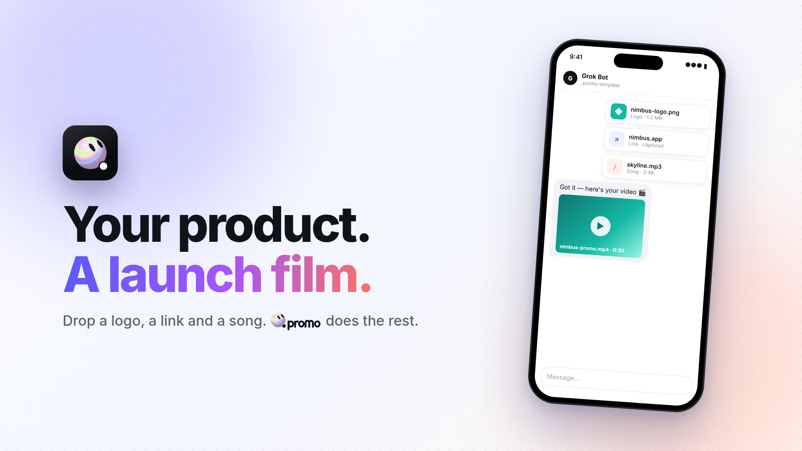

# .promo

.promo turns your product into a short launch video. Pick a style, a foreground (phone, laptop, browser window, product shot or logo), music, length and aspect, preview it live, then paste one request into your bot chat. The bot shows you preview stills before the full render.



## The builder Page

`canvas/builder.tsx` is the source of the **.promo builder** Page: a self-contained Grok Bot canvas (imports only from `grok/canvas`, no network, nothing saved). It has a live animated preview, a timeline with draggable scenes and beat markers, caption styles, accent colors, and a "Paste this in your bot chat" request.

### How a bot installs it

1. Download the pinned file:
   ```
   curl -fsSL https://raw.githubusercontent.com/greedfi/dotpromo/v1/canvas/builder.tsx -o builder.tsx
   ```
2. Verify it:
   ```
   echo "40e9a772ac75779f8d4923091f8f179add6ea05a2b6f7e94445f92386b966cea  builder.tsx" | sha256sum -c -
   ```
3. Write it as a canvas exactly as downloaded, unmodified, titled `.promo builder` (reuse the existing Page if there is one).

If the download or the hash check fails, stop and report it. Never rewrite the code.

## Assets

- `assets/stills/`: preview stills
- `assets/styles/style-5.png`: the holographic .promo character

## License

MIT, see [LICENSE](LICENSE).
